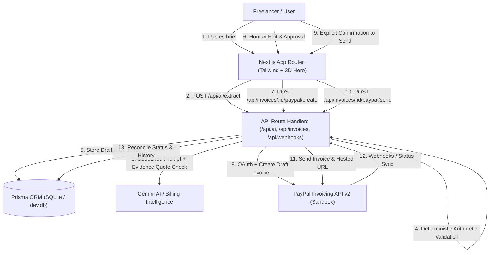

# TrustFlow AI ⚡
> **Your AI-powered billing and payment copilot. From project agreement to payment — intelligently.**

TrustFlow AI transforms unstructured freelancer project briefs into validated, explainable, and trackable PayPal invoices. It features **AI Billing Intelligence** that validates line items against source text, flags missing or ambiguous facts, guarantees mathematical precision with server-side arithmetic, generates PayPal sandbox drafts, supports explicit confirmed sending, and provides context-aware reminder drafting.

Built for the **PayPal AI Hackathon**.

---

## Key Differentiators

1. **AI Billing Intelligence (Not Just a Template)**:
   - Verifies whether every invoice item is supported by the original brief.
   - Extracts exact verbatim source quotes/offsets and validates they actually exist in the original text.
   - Flags missing due dates, ambiguous currency, or unstated terms rather than hallucinating facts.
2. **Deterministic Arithmetic of Record**:
   - The LLM never acts as the financial calculator of record.
   - All line-item extensions ($quantity \times unit$) and subtotal/total reconciliations are verified with server-side decimal math.
3. **End-to-End PayPal Invoicing API Sandbox**:
   - Creates real draft invoices on PayPal sandbox.
   - Enforces human review before creation and explicit user confirmation before sending.
   - Retrieves live PayPal state, tracks payments, handles webhook reconciliation, and prevents regressions (e.g., paid invoices cannot regress to unpaid).
4. **Context-Aware Follow-Up Reminder**:
   - Generates courteous, non-coercive reminder drafts based only on actual invoice facts when an invoice is unpaid and overdue.
   - Draft-only mode: freelancer remains in full control.
5. **Interactive 3D Experience**:
   - Built with Three.js, React Three Fiber, and Drei.
   - Visualizes the data transformation pipeline: *Brief → AI Verification → PayPal Invoice → Payment*.
   - Includes full reduced-motion accessibility and WebGL fallback.

---

## System Architecture



---

## Prerequisites

- **Node.js**: v18.18+ or v20+ / v25+
- **npm**: v9+ or v11+
- **Git**

---

## Quickstart & Local Setup

### 1. Clone & Install Dependencies
```bash
git clone <repo-url>
cd TrustFlow-AI
npm install
```

### 2. Environment Configuration
Copy `.env.example` to `.env`:
```bash
cp .env.example .env
```

| Variable | Required | Default | Description |
| :--- | :--- | :--- | :--- |
| `DATABASE_URL` | Yes | `"file:./dev.db"` | SQLite database connection string |
| `APP_BASE_URL` | Yes | `"http://localhost:3000"` | Base URL of the app |
| `GEMINI_API_KEY` | Optional | `""` | Google Gemini API key. If absent, high-fidelity deterministic Billing Intelligence fallback is automatically used. |
| `PAYPAL_CLIENT_ID` | Optional | `""` | PayPal Sandbox REST App Client ID |
| `PAYPAL_CLIENT_SECRET` | Optional | `""` | PayPal Sandbox REST App Secret |
| `PAYPAL_BASE_URL` | Optional | `"https://api-m.sandbox.paypal.com"` | PayPal REST API endpoint |
| `PAYPAL_WEBHOOK_ID` | Optional | `""` | PayPal Webhook ID for signature verification |

> **Note on Zero-Configuration Demo Mode**: If PayPal or Gemini credentials are not supplied, TrustFlow AI runs in high-fidelity sandbox demo mode with clearly marked badges, deterministic invoice generation, and full UI simulation so judges can evaluate all 8 steps without blockers.

### 3. Initialize Database
```bash
npm run db:push
```

### 4. Run Development Server
```bash
npm run dev
```
Open [http://localhost:3000](http://localhost:3000) in your browser.

---

## Available Scripts

- `npm run dev`: Launch the Next.js development server
- `npm run build`: Build production application
- `npm run start`: Start production server
- `npm run typecheck`: Run TypeScript compilation check (`tsc --noEmit`)
- `npm run lint`: Run ESLint checks
- `npm test`: Run automated Vitest test suite
- `npm run db:push`: Synchronize database schema with Prisma
- `npm run db:studio`: Launch Prisma Studio to inspect SQLite database

---

## Testing & Quality Assurance

Run the test suite:
```bash
npm test
```
The test suite covers:
- Arithmetic integrity (preventing floating point inaccuracies like $0.10 + 0.20 \neq 0.30$)
- Strict Zod schema validation for AI responses
- Source evidence quote existence verification
- Inconsistency detection between line items and stated project totals
- PayPal invoice status transitions and idempotency
- Webhook signature verification and deduplication

---

## Hackathon Evaluation & 3-Minute Demo Flow

1. **0:00–0:20 | Problem & 3D Hero Experience**: Explore the interactive 3D hero showing continuous data flow (*Brief → AI Verify → PayPal Invoice → Payment*).
2. **0:20–0:55 | Brief Intake & AI Extraction**: Paste an unstructured freelance agreement. View structured client, currency, items, and extracted evidence tags.
3. **0:55–1:20 | Billing Intelligence & Inconsistency Warning**: Paste a brief with an arithmetic mismatch (e.g. items total $800 but brief states $950). Inspect deterministic discrepancy alert and fix it in 1 click.
4. **1:20–1:45 | Human Review & Approval**: Freelancer inspects and edits line items. Edits become authoritative.
5. **1:45–2:10 | PayPal Sandbox Draft & Send**: Create a draft on PayPal sandbox, preview hosted link, then click explicit Send confirmation.
6. **2:10–2:30 | Payment Status Synchronization**: Trigger status sync or process payment webhook. Local status reconciles to Paid.
7. **2:30–2:45 | Context-Aware Follow-Up Reminder**: Open an overdue invoice to view an AI-drafted polite reminder with copy-to-clipboard functionality.

---

## Known Limitations & Boundaries (MVP)
- **Escrow / Held Funds**: TrustFlow AI does *not* offer escrow, guarantee delivery, or hold customer funds; it orchestrates official PayPal Invoicing API requests.
- **Email Sending**: Payment reminder is draft-only; no external email sending accounts are accessed automatically.
- **Single Workspace**: Hackathon demo is scoped to a single freelancer workspace without complex multi-tenant onboarding.

